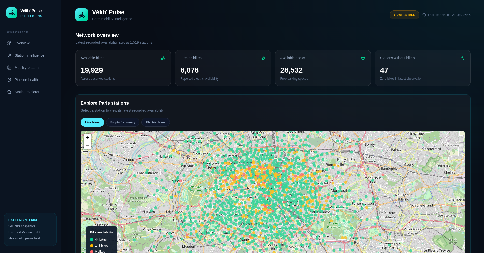
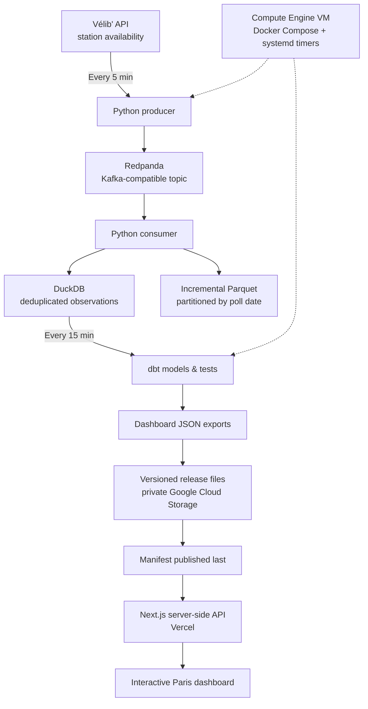

<div align="center">

# 🚲 Vélib' Pulse


<!-- LIVE DASHBOARD -->
<p align="center">
  <a href="https://velib-pulse-gamma.vercel.app/" target="_blank">
    
  </a>
</p>

<p align="center">
  <strong>🚴 LIVE IN PRODUCTION — Explore real Paris bike-sharing data</strong>
</p>

<p align="center">
  <a href="https://velib-pulse-gamma.vercel.app/">
    <strong>🌐 https://velib-pulse-gamma.vercel.app/</strong>
  </a>
</p>

---
<!-- END LIVE DASHBOARD -->


### Real-time bike-sharing data engineering for Paris

**An automated, cloud-deployed pipeline that turns Vélib' station updates into a live analytics dashboard.**

**Python · Redpanda (Kafka API) · DuckDB · Parquet · dbt · Google Cloud · Next.js**

[Architecture](#architecture) · [Engineering highlights](#engineering-highlights) · [Dashboard](#dashboard) · [Run locally](#run-locally) · [Operations](#operations)

</div>

---

<!-- DATA VOLUME START -->
## 📊 Data Volume & Throughput

Vélib' Pulse continuously collects station availability data from approximately **1,519 stations across Paris**, using an automated **5-minute polling interval**.

| Time Window | API Polls | Station Observations |
|---|---:|---:|
| **1 minute (average)** | 0.2 | ~304 |
| **5 minutes** | 1 | ~1,519 |
| **1 hour** | 12 | ~18,228 |
| **24 hours** | 288 | ~437,472 |
| **30 days** | 8,640 | ~13.1 million |

### ⚡ Pipeline Characteristics

- **Ingestion frequency:** Every 5 minutes
- **Analytics refresh:** Every 15 minutes
- **Station observations per poll:** ~1,519
- **Projected daily throughput:** ~437K observations
- **Projected monthly throughput:** ~13.1M observations
- **Storage:** Incremental Parquet files and DuckDB
- **Data quality:** dbt transformations and automated tests
- **Cloud infrastructure:** Google Compute Engine and Cloud Storage

> **Measurement note:** Throughput figures are projections based on 1,519 stations and successful 5-minute polls, not measured daily or monthly production totals. An earlier verified run recorded 15,190 observations across 10 polls, with matching DuckDB/Parquet counts.

<!-- DATA VOLUME END -->

## 📸 Dashboard Preview



**[🚀 OPEN LIVE DASHBOARD](https://velib-pulse-gamma.vercel.app/)**

## Overview

Vélib' Pulse ingests public Paris bike-sharing station availability, processes it through a Kafka-compatible event stream, persists observations in an analytical store, and publishes validated datasets to a web dashboard.

The system is **deployed end to end**: ingestion and analytics run automatically on a Google Cloud VM; dashboard data is published to a private Cloud Storage bucket; and a Next.js frontend serves the results through server-side API routes on Vercel.

| Dimension | Implementation |
| --- | --- |
| Source | Vélib' station availability API |
| Collection cadence | Every **5 minutes** |
| Analytics / publishing cadence | Every **15 minutes** |
| Coverage | Approximately **1,519 stations** observed in the initial deployment |
| Event transport | Redpanda, using the Kafka protocol |
| Storage | DuckDB + incremental, date-partitioned Parquet |
| Transformation & quality | dbt models and tests |
| Cloud infrastructure | Google Compute Engine + private Cloud Storage |
| Frontend | Next.js, deployed on Vercel |

> **Data freshness:** The ingestion job and the published dashboard run on different schedules. A dashboard snapshot can be older than the latest collected observations. The UI's freshness indicator should not be interpreted as a complete uptime or SLA measurement.

## Architecture



**Why this architecture?** Kafka-compatible streaming decouples production from consumption; DuckDB supports efficient local analytical queries; Parquet provides portable columnar history; dbt separates transformation logic from ingestion; and immutable, versioned JSON releases let the frontend consume a consistent dataset without querying the database directly.

## Engineering highlights

### 1. Automated, repeatable ingestion

- A `systemd` timer triggers the Docker Compose ingestion job **every five minutes**.
- A Python producer publishes station snapshots to a Redpanda topic.
- A consumer persists observations to DuckDB and incremental Parquet.
- Event IDs are deduplicated in the analytical store, supporting consistent counts across storage formats.

### 2. Analytics with data quality checks

- A separate timer refreshes analytics **every fifteen minutes**.
- dbt models prepare data for station-level views, hourly activity, pipeline health, and historical insights.
- The initial deployed run reported **six dbt models and forty tests**, with **46 successful model/test checks** and no warnings or errors.
- Health reporting includes poll coverage, missing polls, freshness, observation counts, and DuckDB/Parquet consistency.

### 3. Consistent dashboard publishing

Dashboard exports are published as immutable release files:

```text
 gs://<private-bucket>/dashboard/
 ├── manifest.json
 └── releases/
     └── <release-id>/
         ├── stations.json
         ├── hourly.json
         ├── health.json
         └── insights.json
```

The upload process publishes the **manifest last**. The frontend reads a single manifest to identify a release and then loads its four corresponding JSON files, avoiding mixed-version dashboard data.

### 4. Private cloud storage and server-side access

- Google Cloud Storage has **public access prevention** enabled.
- The VM writes published artifacts using its own service account.
- Vercel reads GCS objects through a separate, read-only service account; credentials stay server-side.
- The Next.js API validates the requested paths before reading from the bucket.
- The frontend checks the manifest every minute and downloads the larger JSON payloads **only when the release ID changes**.
- A short, per-instance server cache reduces repeated manifest reads. This is **not** a globally shared cache.

### 5. Operational visibility

The pipeline exposes practical quality signals rather than claiming unmeasured reliability:

| Signal | What it tells you |
| --- | --- |
| Poll coverage | Recorded polls versus expected polls since the configured automation start |
| Missing polls | Collection intervals not represented in the recorded history |
| Observation freshness | Age of the latest observation in the generated health snapshot |
| Storage consistency | Whether DuckDB and Parquet observation counts agree |
| Duplicate event IDs | Whether the analytical store contains duplicate event identifiers |

**Not yet benchmarked:** Kafka duplicate delivery rate, end-to-end processing lag, recovery time, long-term uptime, and production-scale throughput. These are intentionally not presented as measured results.

## Dashboard

The live dashboard brings the pipeline's outputs together in one interface:

- **Interactive Paris map** with station search and bike/dock availability.
- **Station-level status** including available mechanical and electric bikes.
- **Hourly analytics** for activity patterns.
- **Historical insights** derived from stored observations.
- **Pipeline health** including freshness, polling coverage, and storage consistency.


## Technology stack

| Layer | Technology |
| --- | --- |
| Data source | Vélib' public API |
| Ingestion | Python |
| Streaming | Redpanda / Kafka protocol |
| Analytical storage | DuckDB |
| Data lake format | Apache Parquet |
| Transformations and tests | dbt |
| Orchestration | `systemd` timers and Docker Compose |
| Compute | Google Compute Engine |
| Artifact storage | Google Cloud Storage |
| Web application | Next.js, React, TypeScript |
| Web hosting | Vercel |

## Run locally

### Prerequisites

- Docker Engine and Docker Compose
- Git
- Node.js and npm (for the frontend)
- Credentials/configuration required by the Vélib' API and deployment scripts, where applicable

Clone the repository:

```bash
 git clone https://github.com/revanthpuvanes/velib-pulse.git
 cd velib-pulse
```

Review `docker-compose.yml` and the environment configuration before running. The local workflow and the production override (`docker-compose.prod.yml`) serve different purposes; **do not run the cloud publishing script without a configured GCP project and bucket**.

To build and start the services defined by the local Compose file:

```bash
 docker compose up -d --build
```

To run the frontend locally:

```bash
 cd web
 npm install
 npm run dev
```

The deployed frontend expects a server-side GCS configuration for its `/api/data/...` endpoints. Local dashboard data will not load unless those environment variables and permissions are configured. **Never commit service-account JSON, `.env` files, or other secrets.**

## Operations

The production deployment uses two `systemd` timers on the Compute Engine VM:

| Job | Schedule | Responsibility |
| --- | --- | --- |
| `velib-pipeline.timer` | Every 5 minutes | Fetch, stream, consume, persist |
| `velib-analytics.timer` | Every 15 minutes | Run analytics, export JSON, upload releases, publish manifest |

Useful VM diagnostics:

```bash
 systemctl status velib-pipeline.timer velib-analytics.timer --no-pager
 journalctl -u velib-pipeline.service -n 50 --no-pager
 journalctl -u velib-analytics.service -n 50 --no-pager
```

**Cloud cost note:** The VM, storage, and cross-cloud traffic may incur charges even with low dashboard traffic. A Google Cloud budget alert is a notification, **not** a spending cap.

## Design decisions and trade-offs

| Decision | Benefit | Trade-off |
| --- | --- | --- |
| Five-minute ingestion | Frequent source observations | Does not guarantee a new dashboard snapshot every five minutes |
| Fifteen-minute analytics | Bounded transformation and upload work | Dashboard data may lag behind ingestion |
| DuckDB + Parquet | Simple analytics and portable history | Requires consistency checks between representations |
| Immutable JSON releases | Consistent, easy-to-serve frontend data | New releases create additional stored objects |
| Private GCS + server-side proxy | No public bucket access or browser credentials | Adds serverless requests and cloud egress |
| Manifest-based client refresh | Avoids re-downloading unchanged data | Freshness depends on polling and cache intervals |

## Future improvements

- Report **rolling 24-hour poll coverage** alongside cumulative coverage, so early missed polls do not permanently dominate the percentage.
- Separate **latest ingestion age** from **latest published dashboard age** in the UI.
- Benchmark ingestion latency, duplicate delivery, recovery, and resource consumption.
- Improve incremental upload efficiency as the Parquet history grows.
- Reduce reliance on long-lived service-account keys through a suitable keyless authentication design.

## Project status

**Live deployment completed.** The automated ingestion, analytics, GCS publishing, and web dashboard were confirmed operational during the initial deployment on **28 October 2026**. The numbers above are initial deployment observations, not promises of continuous uptime or fixed dataset size.

---

<div align="center">

Built as an end-to-end data engineering portfolio project focused on **reliable ingestion, analytical modeling, cloud delivery, and operational transparency**.

</div>
